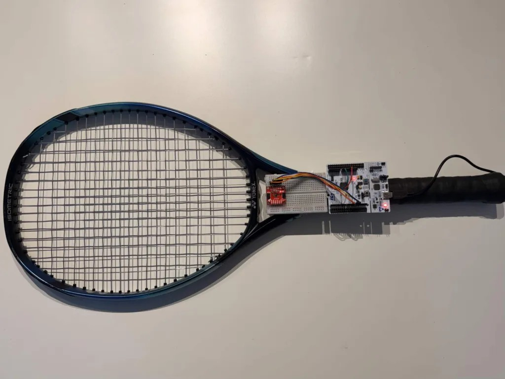
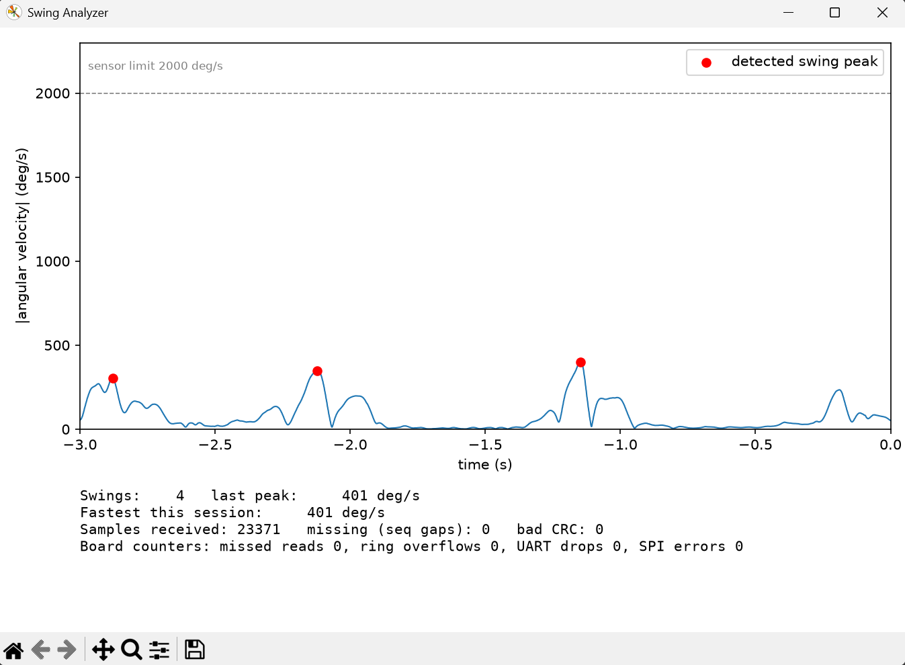

# STM32 Tennis Swing Analyzer

A swing analyzer for a tennis racket, built with an STM32 Nucleo-F446RE and a BMI270 IMU. It samples the IMU at 1 kHz, detects each swing on the microcontroller, and shows swing speed and swing count live on a Python dashboard.

<p align="center">
  
</p>

## Results

| Metric | Result | Notes |
| --- | --- | --- |
| Sampling rate | 1.000 kHz | Oscilloscope on the D7 debug pin |
| Timing jitter | 44 ns | Peak-to-peak over 299,996 samples (1 ns standard deviation), confirmed on the oscilloscope |
| Dropped samples | 0 | 0 of 299,997 over 5 minutes, and 0 of 99,589 during 20 swings |
| Gyroscope scale error | 0.78% | Mean over 5 rotations of exactly 720°, worst 1.11% |
| Swing detection | 20/20 | Practice swings, with 0 false detections |

These are slow to medium practice swings, since the board is still wired to a laptop. Raw logs and scope screenshots are in [`results/`](results/).

## How it works

I built this to learn the STM32 properly, meaning timers, DMA and interrupts instead of `HAL_Delay` in a loop. Every number above had to come from a saved recording or a scope screenshot, so the firmware is built around being able to prove what it did.

- TIM2 interrupts every 1 ms and starts a 14 byte SPI DMA read of the accelerometer and gyroscope. Each sample gets a timestamp from the Cortex-M4 cycle counter and a sequence number, then goes into a ring buffer.
- The main loop runs the swing detection state machine and sends every sample and swing to the PC as CRC-checked binary packets over UART DMA.
- On the PC, a gap in the sequence numbers means a lost sample, and the board's own counters show where it was lost.

A swing starts when the angular velocity stays above 300 °/s and ends when it drops below 150 °/s, and the peak is reported as the swing speed. Rotation about the handle is left out. The first version counted spinning the racket in my hand as swings (8 false ones in one recording), and those spins turned out to be almost entirely rotation about that axis.

The part I like most is the dropped-sample check. A counter that has only ever read 0 doesn't prove anything, so I slowed the UART to 115200 baud on purpose. It lost 55.8% of the samples, which matches the calculation, and both the PC and the board counted every one!

## Hardware

- STM32 Nucleo-F446RE (Cortex-M4 at 180 MHz)
- SparkFun 6DoF IMU Breakout (BMI270), with the ADR jumper cut for SPI mode
- Breadboard and jumper wires

| BMI270 | Signal | Nucleo |
| --- | --- | --- |
| 3V3 | Power | 3V3 |
| GND | Ground | GND |
| SCL | SCK | D13 (PA5) |
| SDA | MOSI | D11 (PA7) |
| ADR | MISO | D12 (PA6) |
| CS | Chip select | D10 (PB6) |

D7 (PA8) is a debug pin that goes high during each sensor read, for checking the timing on an oscilloscope. Data goes to the PC through the Nucleo's USB port.

## Building and running

Open [`firmware/cubeide/`](firmware/cubeide/) in STM32CubeIDE, build, and flash. The source is in [`firmware/App/`](firmware/App/). The BMI270 needs an 8 KB configuration file at every power up, which comes from Bosch's [BMI270_SensorAPI](https://github.com/boschsensortec/BMI270_SensorAPI) (BSD-3-Clause).

On the PC:

```
pip install -r python/requirements.txt
python python/swing_dashboard.py --port COM10 --save run.bin
python python/analyze_log.py run.bin
```

<p align="center">
  
</p>

The packet and swing detection code also builds on a PC, where the tests check it against the Python version on every push:

```
make -C firmware/host_test
python python/test_host.py
```

## Testing

The jitter is how much the time between sensor reads varies, measured from the cycle counter timestamps and cross-checked on the oscilloscope.

I checked the gyroscope by turning the racket exactly two full turns on a spinning tray, lining up a mark each time. All five trials read slightly high, and the error is within the BMI270's specified ±2% sensitivity tolerance.

Swing detection was tuned on one recording and tested on a separate one, which also included spinning the racket in my hand, bouncing a ball and flipping the racket.

## Known issues

- It is tethered. Full speed swings would pull the jumpers out, so every swing so far is a practice swing.
- Leaving out rotation about the handle fixed the false detections, but it depends on how the board is mounted.
- The BMI270 samples on its own 1600 Hz clock, so each reading can be up to 0.6 ms old. The jitter figure describes when the STM32 reads the sensor, not when the sensor sampled.
- The sensor's built-in calibration (CRT) should bring the gyroscope error down to about 0.4%. I wrote it following Bosch's driver and the sensor never finishes it, so it is not in this version.
- The gyroscope check used a spinning tray and a mark on the table, so it is only as exact as my lineup.

## Next steps

- Go wireless with a battery and a 3D-printed mount, so swings can be recorded at full speed
- Get CRT working
- Use the BMI270's data-ready interrupt so reads line up with the sensor's own clock
- Add a demo video of real swings with the dashboard running
